# StillMind — complete visual tour

This page is the **whole StillMind app as pictures and words**. ChatGPT cannot click the live JavaScript app. It can open this page and look at the screenshot files.

**Live interactive app (needs a browser):** https://jodilrigney.github.io/stillmind/

**This visual tour:** https://jodilrigney.github.io/stillmind/overview.html

StillMind is a privacy-first mental-health calm space. Health data stays on the device. Nothing is uploaded to a server. “Google” in the app is only a local label so one phone can remember you.

It is not a replacement for therapy, emergency care, or a clinician.

## Opening

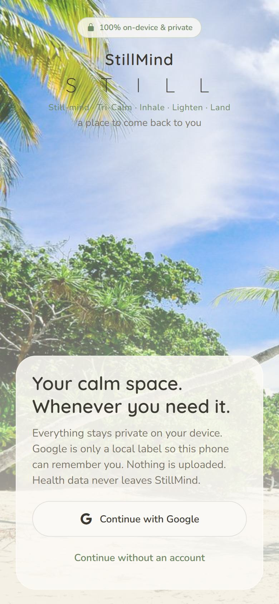

Continue without an account, or use Google as a local label only. Copy says everything stays private on the device and health data never leaves StillMind.

## Home (CalmKit / STILL)

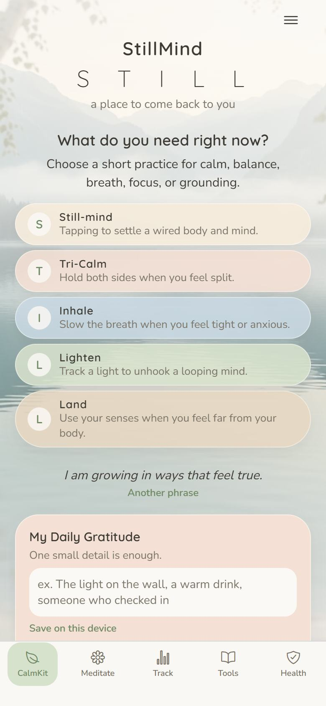

The home screen is a quiet landing with the mark **STILL**:

- **S — Still-mind:** tapping to settle a wired body and mind
- **T — Tri-Calm:** hold both sides when you feel split
- **I — Inhale:** slow breathing when tight or anxious
- **L — Lighten:** track a light to unhook a looping mind
- **L — Land:** senses and body when you feel far from yourself

Also on home: a daily affirmation, optional gratitude kept on the device, and tabs for CalmKit, Meditate, Track, Tools, and Health.

## Still-mind (Reset)

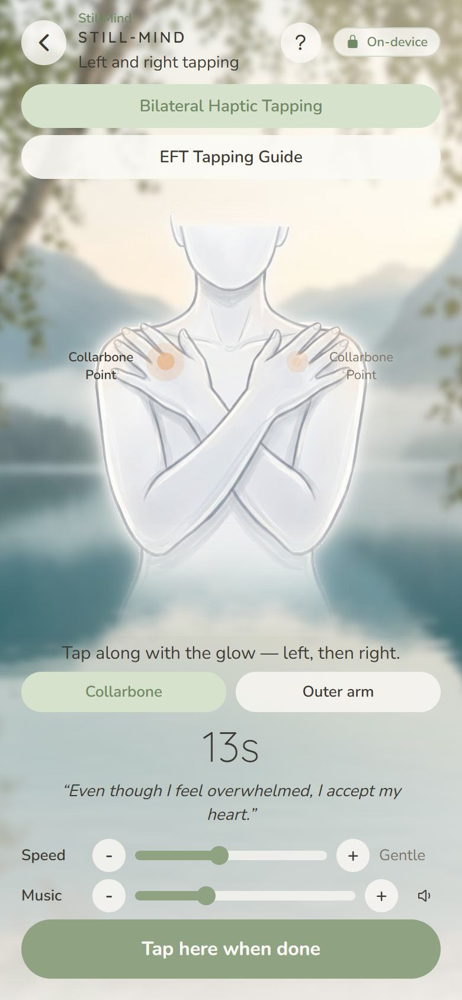

Bilateral haptic tapping. A glow moves left, then right. Follow along on the body.

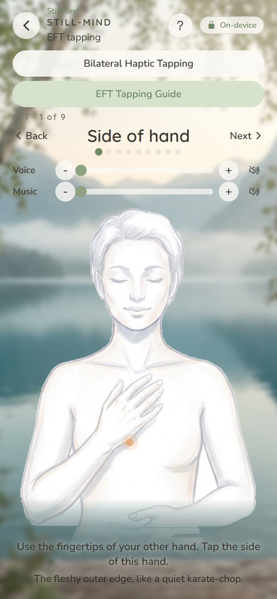

EFT tapping guide. Nine points, one at a time, with optional voice.

## Tri-Calm

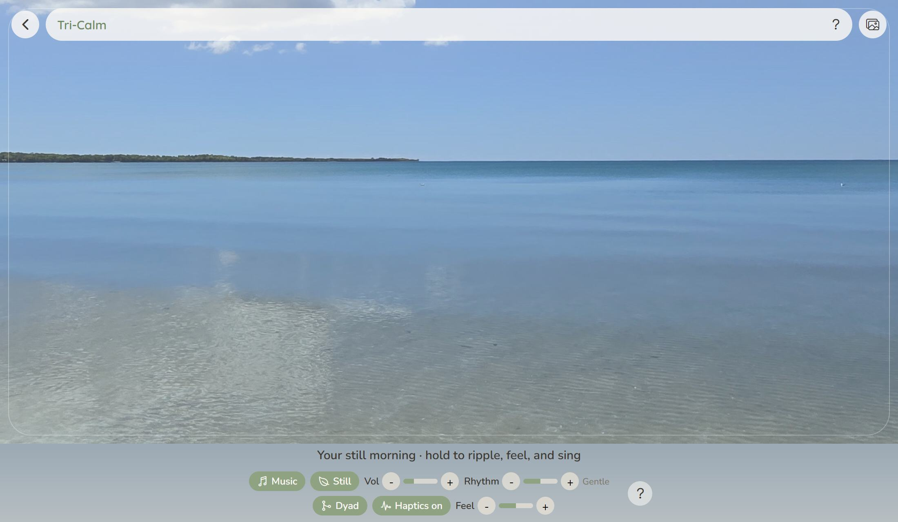

Hold both sides of the water when you feel split. Optional music, rhythm, dyad notes, and haptics.

## Inhale

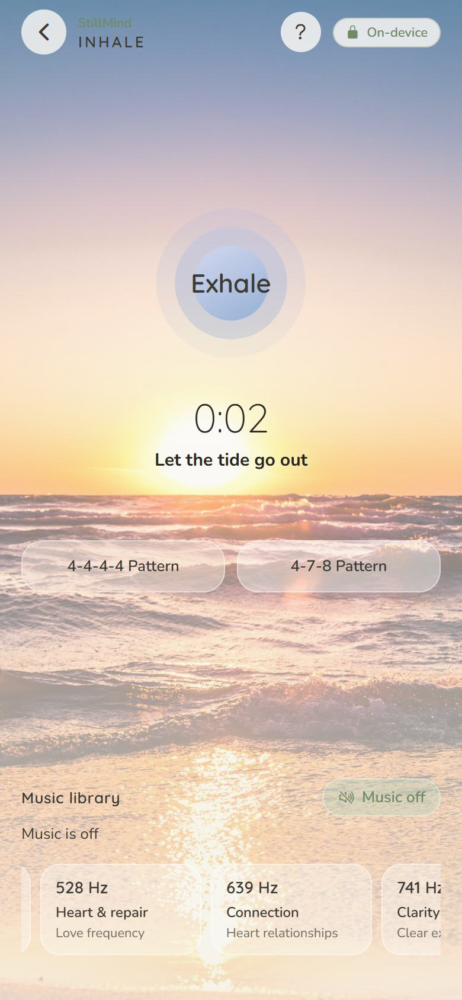

Paced breathing. Box 4-4-4-4 or 4-7-8. Optional tones.

## Lighten (the firefly)

Route: `/follow`

Lighten is a forest-style tracking scene with a **single organic firefly**. You follow that moving light. It is **not** Simple EMDR. From Lighten you can open Simple EMDR.

## Simple EMDR (inside Lighten)

Route: `/emdr`

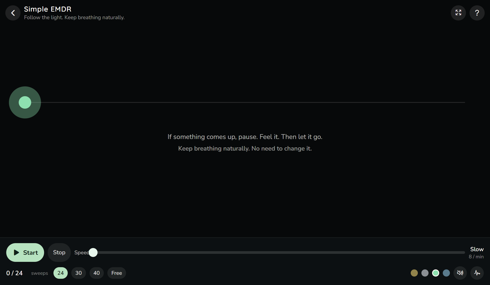

Bilateral eye-movement helper: **one light** sliding left and right on a dark line. Not EMDR therapy with a clinician.

- Starts **paused**. Default pace is **Slow**, about **8 one-way sweeps per minute**
- **Start / Pause / Stop**, speed slider, set length **24 / 30 / 40 / Free**
- **Tap the dark screen** to pause or resume
- **Drag the light along the line** to the place a feeling showed up
- “If something comes up, pause. Feel it. Then let it go.”
- “Keep breathing naturally. No need to change it.”

## Land

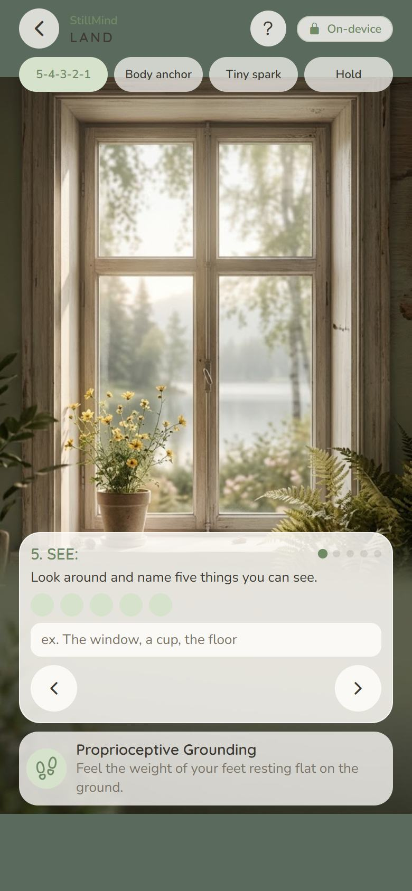

Senses (5-4-3-2-1), body anchor, tiny spark, or Hold (name what feels heavy). Kept on the device.

## Meditate

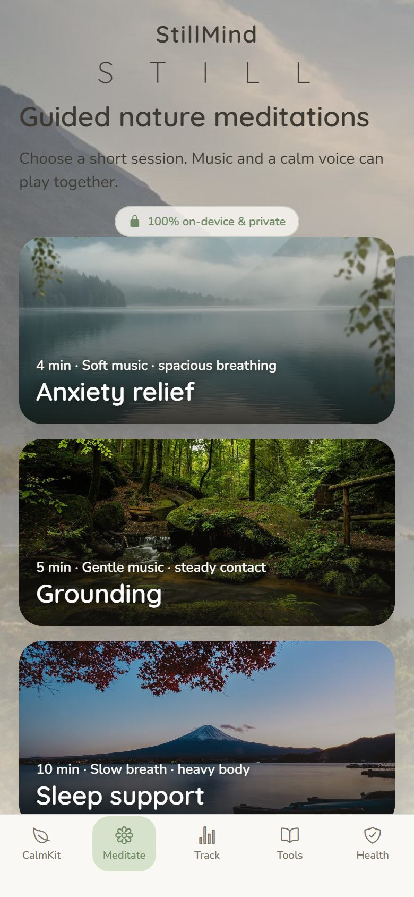

Guided nature meditations such as Anxiety relief, Grounding, Sleep support, and Stress reduction.

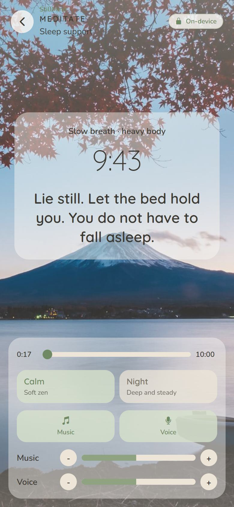

Sleep support: slow body scan. You do not have to fall asleep. Rest counts.

## Track

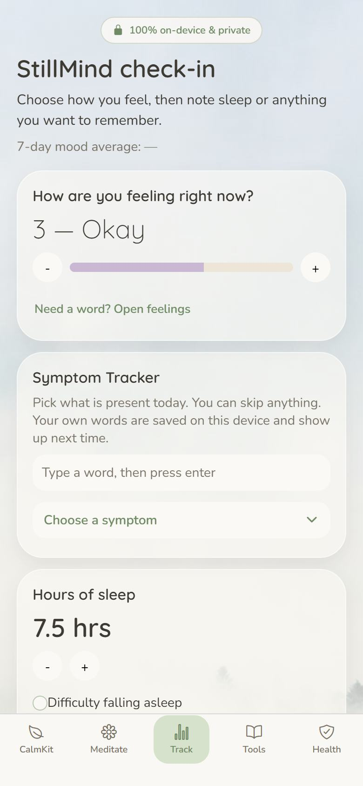

How you feel, symptoms, sleep, notes — on device only.

## Tools

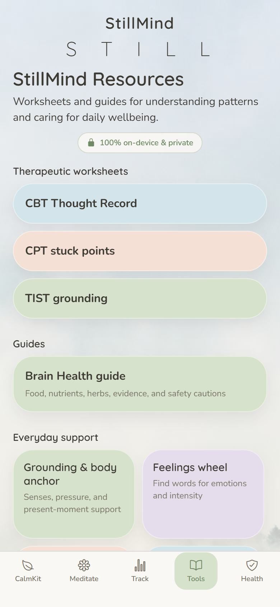

Worksheets: CBT Thought Record, CPT stuck points, TIST grounding, Brain Health, grounding, feelings wheel.

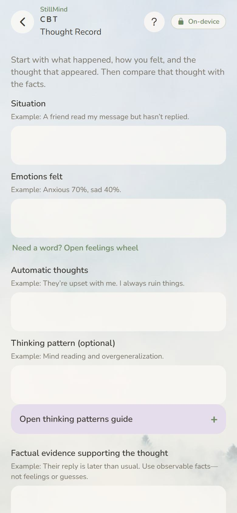

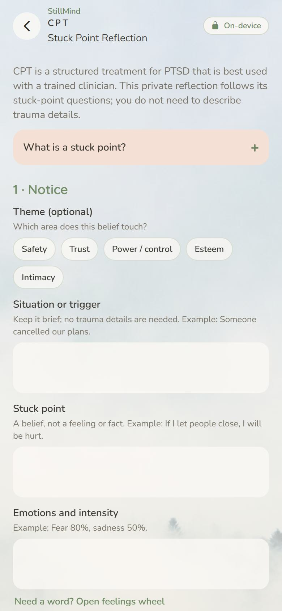

CPT notes it is best used with a trained clinician. You do not need to describe trauma details.

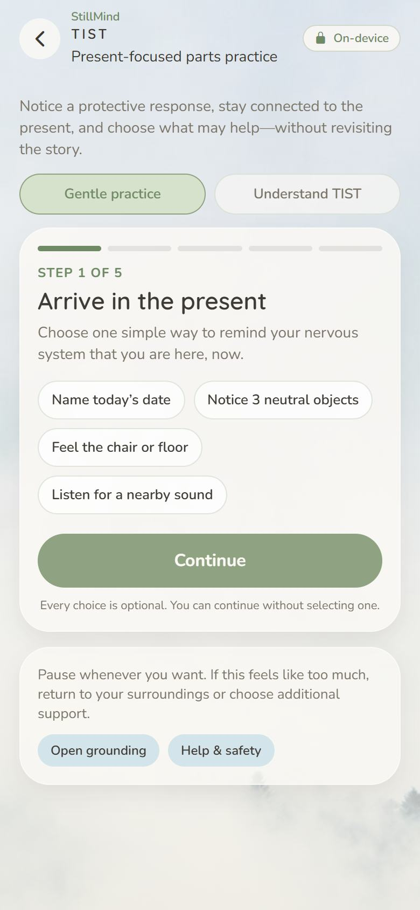

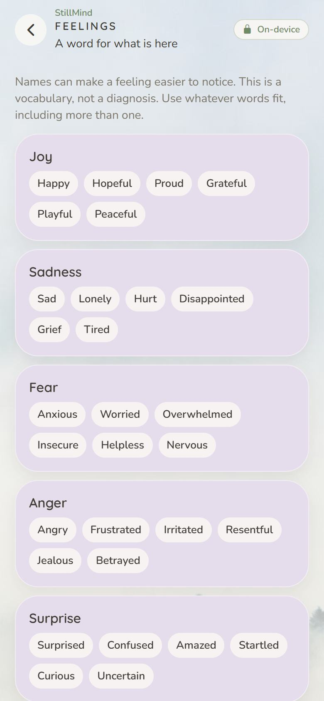

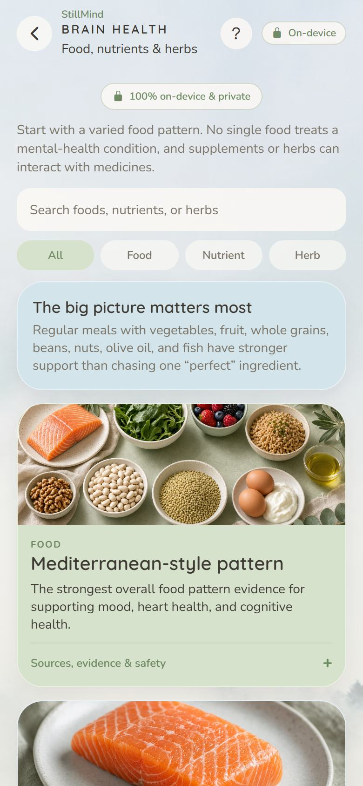

## Health & Safety

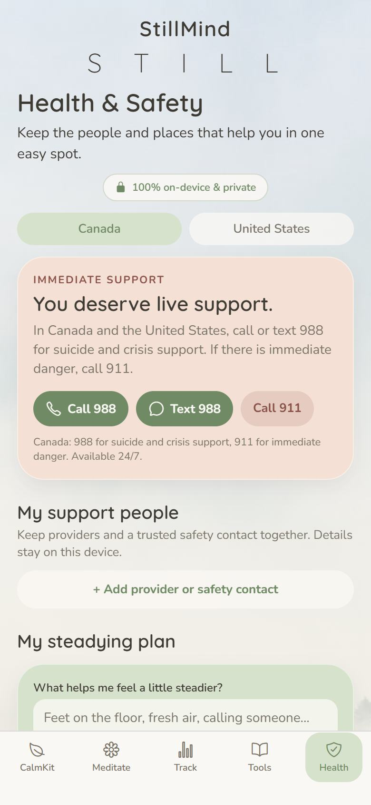

Immediate support (988 / 911), your people, and a steadying plan. Details stay on the device.

## Share / doctor notes

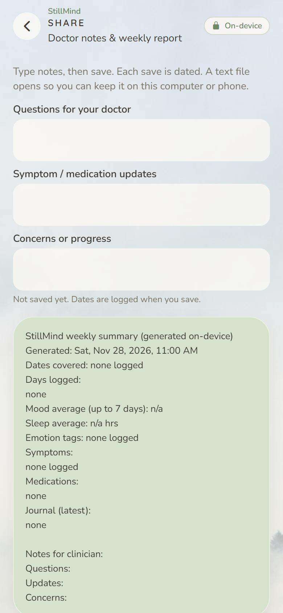

Optional notes you can save as a text file on this device. StillMind does not upload them.

## Privacy

- On-device storage
- No health data upload
- Optional local “Google” label is not cloud sync of clinical data

## What a language model cannot do

Opening the live app URL does not reveal screens, because the app is a JavaScript single-page app. Use this visual tour instead. ChatGPT still cannot press Start or drag the light. It can see every screen from the pictures above.
